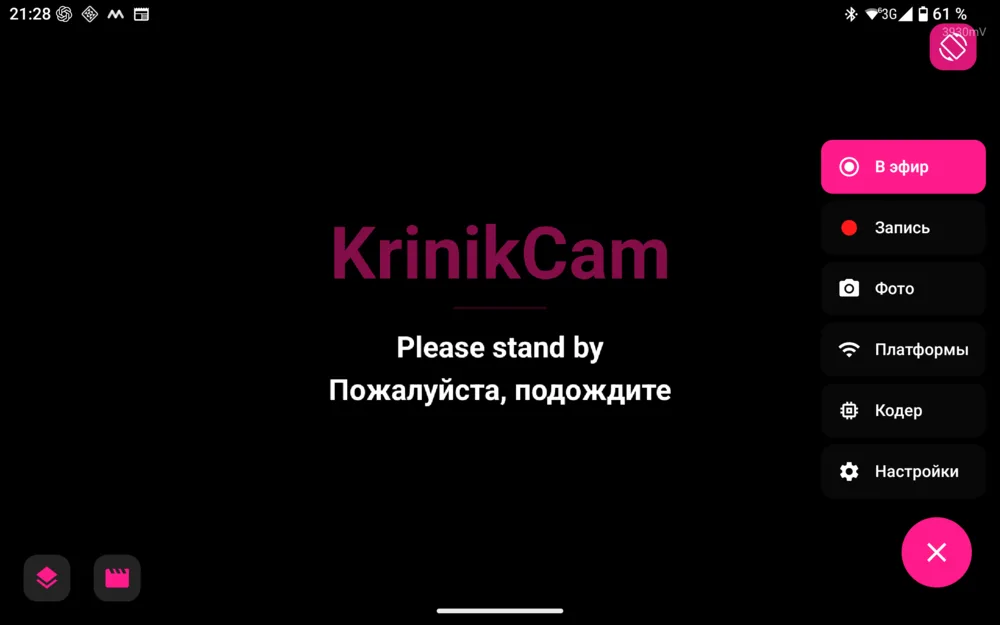
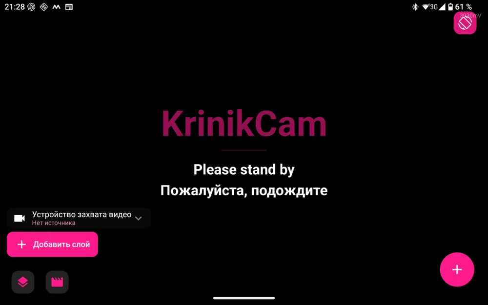
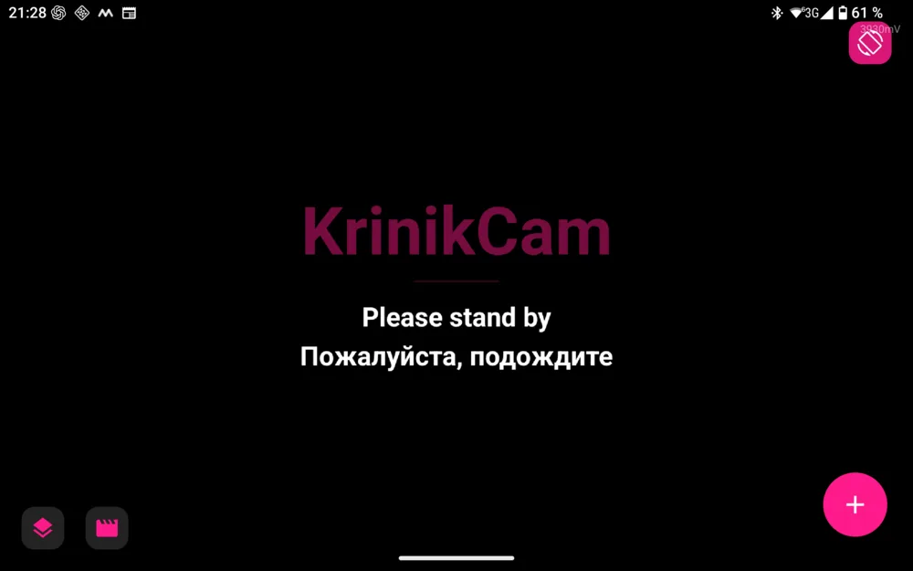
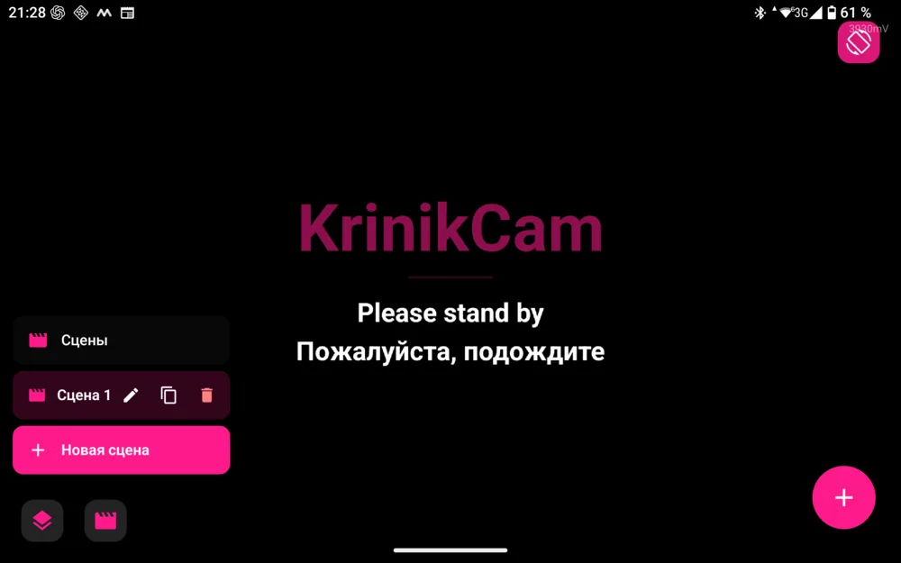
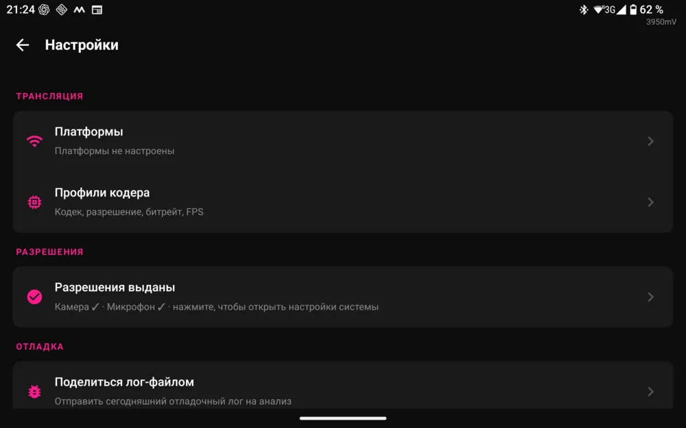
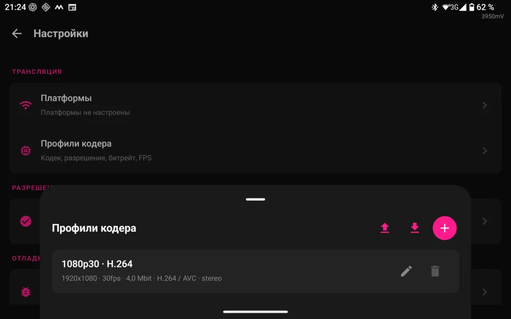

<a name="english"></a>

<h1 align="center">KrinikCam</h1>

<p align="center">
  <a href="#english"></a>
  &nbsp;
  <a href="#russian"></a>
</p>

<!-- tagline: from GOAL.md («аналог OBS для мобильных устройств на базе Android») -->
<p align="center"><b>A mobile OBS for Android</b><br>
Open source · For streamers and bloggers</p>

<p align="center">
  <a href="LICENSE"></a>
  <a href="#en-4"></a>
  <a href="https://kotlinlang.org"></a>
  <a href="https://github.com/MikalaiKryvusha/KrinikCam/releases/latest"></a>
  <a href="https://github.com/MikalaiKryvusha/KAIF"></a>
</p>

[Читать по-русски →](#russian)

**KrinikCam turns an Android phone or tablet into a small streaming studio.** Plug a USB webcam in through OTG (or use
the device's own cameras), build a scene from layers, and go live over RTMP — or record the scene to the gallery.
It is made by a blogger and streamer for bloggers and streamers, so that you deal with your content and your viewers,
not with the camera's settings.

<p align="center">
  <a href="https://github.com/MikalaiKryvusha/KrinikCam/releases/latest"></a>
  &nbsp;&nbsp;
  <a href="https://apps.obtainium.imranr.dev/redirect?r=obtainium://app/%7B%22id%22%3A%22com.kriniks.kcam%22%2C%22url%22%3A%22https%3A%2F%2Fgithub.com%2FMikalaiKryvusha%2FKrinikCam%22%2C%22author%22%3A%22MikalaiKryvusha%22%2C%22name%22%3A%22KrinikCam%22%2C%22additionalSettings%22%3A%22%7B%7D%22%7D"></a>
</p>

<p align="center">Android 13 or newer, 64-bit. Every version: <a href="https://github.com/MikalaiKryvusha/KrinikCam/releases">Releases</a>.</p>

<p align="center">
  
  
</p>

Sections: [1 What it does](#en-1) · [2 Screens](#en-2) · [3 Two builds](#en-3) · [4 Install](#en-4) · [5 Quick start](#en-5) · [6 Build it yourself](#en-6) · [7 Under the hood](#en-7) · [8 Status and plans](#en-8) · [9 Author and licence](#en-9).

<a name="en-1"></a>
### 1. What it does

**Sources and the scene**

1. Shows a USB webcam (UVC, any brand) full screen; the device's built-in cameras work as sources too.
2. Builds the picture from **layers** (the camera is just a layer, as in OBS): cameras and image overlays, with order
   and visibility. Layers move, scale and rotate with your fingers and snap magnetically.
3. Runs **several independent cameras at once** on separate layers (a USB webcam and the selfie camera), and can put
   **one camera on several layers** (like OBS «duplicate source», picture-in-picture).
4. Rotates the canvas (0° / 90° / 180° / 270°) and the content of each layer.
5. Keeps **scenes**: named, saved across restarts, switched, duplicated, renamed. Each scene has its own
   **transition** — instant, fade or slide, 0.2–1.5 s. No black frame on a switch: the last frame is held until the
   new scene really gives a picture.

**Going live and recording**

6. Streams over **RTMP** to YouTube, Twitch or your own server, in landscape and portrait.
7. Streams to **several platforms at once**: each output fails on its own and reconnects on its own. *(A live
   check with several real keys at once is still ahead.)*
8. **A broadcast ends only when you press Stop**: reconnection without a cap on attempts, the stream keeps going with
   the screen off and the app in the background, and the status is loud on screen and in the notification
   («off air 00:28 · try 7»). Checked live: a 3-minute outage, the stream came back on its own.
9. **Adaptive bitrate** with live telemetry: the bitrate goes down on congestion and back up when the network
   recovers. Its floor is set in the encoder profile (250 kbps by default), so on a weak 3G uplink the stream degrades
   instead of stopping. A frozen connection is turned into a reconnect instead of a silent «green LIVE».
10. **Encoder profiles**: H.264 / HEVC / AV1 (what your device's hardware supports — the app scans the codecs),
    resolution, FPS, bitrate, stereo / mono audio. Profiles are exported and imported as files.
11. **Records the composed scene** to the gallery (`DCIM/KrinikCam`, .mp4) and takes photos. The badge says **FILE**
    while recording and **LIVE** while on air.
12. Shows a «Please stand by» frame when the camera drops off, instead of a frozen picture.

**Everyday**

13. Remembers the USB camera, so Android does not ask for permission every time.
14. Interface in English and Russian; the language follows the system or is chosen by hand.
15. A built-in user guide in Settings.

<a name="en-2"></a>
### 2. Screens

| Screen | What you do there |
|---|---|
| Main | the full-screen preview; the pink button opens the menu: Go live, Record, Photo, Platforms, Encoder, Settings |
| Layers | the list of layers of the scene, the source of each one, add a layer |
| Scenes | switch, rename, duplicate, delete scenes, create a new one |
| Settings | platforms (stream keys), encoder profiles, permissions, sharing the log file |
| Encoder profiles | codec, resolution, bitrate, FPS; export and import |

<p align="center">
  
  
  
</p>
<p align="center">
  
</p>

<sub>Screenshots: the release build KCAM (0.8 build 74, before the 0.9 polish) on a Headwolf Titan 1 tablet, Russian interface. The camera layer is switched to «No source», so the
preview shows the «Please stand by» frame instead of a live camera picture.</sub>

<a name="en-3"></a>
### 3. Two builds

| Build | Package | What is inside |
|---|---|---|
| **KCAM** | `com.kriniks.kcam` | the release: no developer menu and no debug tools, shrunk with R8. This is the one on the Releases page |
| **Debug KCAM** | `com.kriniks.kcam.debug` | for development: the developer menu and the test harness (a virtual camera, streaming to a file) |

Both can live on one device side by side.

<a name="en-4"></a>
### 4. Install

**What you need:** Android 13 or newer (API 33), a 64-bit device. For an external camera — a UVC USB webcam
and an OTG cable or adapter.

**APK from GitHub.** Download the APK from [the latest release](https://github.com/MikalaiKryvusha/KrinikCam/releases/latest),
open it, and when Android asks, allow your browser or file manager to install apps.

**Obtainium.** Tap **Get it on Obtainium** at the top, or in [Obtainium](https://github.com/ImranR98/Obtainium) add
the app by the repository address `https://github.com/MikalaiKryvusha/KrinikCam` — it will take the APK from GitHub
Releases and keep KrinikCam updated.

> ⚠️ **Updating from 0.8 or older: uninstall the old KrinikCam first.** Release 0.9 is signed with a new key, so Android
> will not install it over a previous release. Your scenes and profiles stored in the old app are removed with it;
> export the encoder profiles to a file beforehand if you need them.

<a name="en-5"></a>
### 5. Quick start

1. Connect the USB webcam through the OTG adapter (or skip this and use the built-in camera).
2. Open KrinikCam and allow the camera, the microphone and the USB device.
3. You see the preview full screen. The left buttons open **Layers** and **Scenes**.
4. Tap the pink button → **Platforms** → add the stream key of your platform.
5. Tap **Go live**. To record to the gallery instead, tap **Record**.

> **PRO:** make an encoder profile per platform (**Settings → Encoder profiles**) and keep the minimum bitrate low
> if you stream over mobile data — the stream will slow down instead of breaking.

<a name="en-6"></a>
### 6. Build it yourself

#### Requirements

- JDK 17: the modules compile with `jvmToolchain(17)`.
- The Android SDK with platform 35.
- Node.js 18+ for the scripts in `tools/`. `node tools/env.mjs` shows which Java, SDK and adb the tools pick.

#### Get the code

```bash
git clone https://github.com/MikalaiKryvusha/KrinikCam.git
cd KrinikCam
node tools/setup.mjs                      # first-time setup
```

#### Build

```bash
node tools/build.mjs --no-ui              # Debug KCAM: app/build/outputs/apk/debug/
node tools/build.mjs --no-ui --release    # KCAM (R8): app/build/outputs/apk/release/
```

`tools/build.mjs` wraps Gradle: `./gradlew assembleDebug` and `./gradlew assembleRelease` (`gradlew.bat` on Windows)
give the same APKs.

#### Signing a release

The keys stay outside git: `.env` in the project root and the `keystores/` folder are both in `.gitignore`. Put your
release keystore under `keystores/`; a new one can be made with `keytool`, for example:

```bash
keytool -genkeypair -keystore keystores/kcam-release.jks -storetype PKCS12 -alias <your-alias> -keyalg RSA -keysize 4096 -validity 10950
```

Then put the four variables the build reads into `.env` at the project root:

```ini
KCAM_RELEASE_STORE_FILE=keystores/kcam-release.jks
KCAM_RELEASE_STORE_PASSWORD=<store password>
KCAM_RELEASE_KEY_ALIAS=<your-alias>
KCAM_RELEASE_KEY_PASSWORD=<key password>
```

The store path is relative to the project root or absolute, with forward slashes. An environment variable with the same
name overrides `.env` (for CI). The same four `KCAM_DEBUG_*` values give Debug KCAM one shared key on every machine;
without them, the debug build uses the machine's own debug key. Without `KCAM_RELEASE_*` the release build is signed
with the debug key and Gradle prints a WARNING: such an APK is for local testing only, never for publishing. Keep a copy
of the key outside the project: a release signed with another key does not install over the previous one.

#### Project notes

- AndroidUSBCamera, RootEncoder and FreeDroidWarn come from [JitPack](https://jitpack.io), so the first build needs
  network access to it.
- Two builds install side by side: Debug KCAM (`com.kriniks.kcam.debug`) and KCAM (`com.kriniks.kcam`), see
  [3 Two builds](#en-3).

<a name="en-7"></a>
### 7. Under the hood

Kotlin, Jetpack Compose + Material3, Hilt, Room, DataStore; a multi-module Gradle project.

```
Sources: USB webcam (AndroidUSBCamera) · built-in cameras (Camera2) · images
  → GL compositor (OpenGL ES): draws all layers of the scene into one frame
  → MediaCodec hardware encoder (RootEncoder) → RTMP to one or several platforms
                                              → .mp4 into the gallery + the on-screen preview
```

| Module | Role |
|---|---|
| `:app` | entry point, screens, navigation |
| `:core:common` · `:core:ui` · `:core:logging` | shared models, the design system, the file logger |
| `:feature:usb` | UVC camera detection, hot-plug, preview |
| `:feature:capture` | the registry of video and audio sources |
| `:feature:codec` | the hardware codec scanner |
| `:feature:streaming` | the compositor, the encoder, RTMP |
| `:data:profiles` | stream, encoder and scene profiles |

Where things are: [PROJECT_STRUCTURE_EXTERNAL_MAP.md](PROJECT_STRUCTURE_EXTERNAL_MAP.md); how they work:
[PROJECT_ARCHITECTURE_INTERNAL_MAP.md](PROJECT_ARCHITECTURE_INTERNAL_MAP.md).

<a name="en-8"></a>
### 8. Status and plans

Active development. Done: the USB preview, RTMP, the compositor «camera = layer», several sources, scenes and
transitions. The current phase is multistreaming, codecs and **a stream that survives a bad mobile network**.

**Planned** (not in the app yet): camera image controls and smart auto-adjustment of USB cameras (exposure, white
balance — profiles «balanced», «fast», «low light»…), on-screen monitoring (network, ping, dropped frames, CPU/GPU,
battery), audio sources and filters, background music and video overlays, reactions and stickers over the stream,
platform frames (16:9 for YouTube and 9:16 for Instagram from one camera), localization into the main world languages.
The roadmap is [MASTER_PLAN.md](MASTER_PLAN.md), the current state is [STATUS.md](STATUS.md).

<a name="en-9"></a>
### 9. Author and licence

Author: **Mikalai Kryvusha aka KOT KRINIK** (Николай Кривуша, Кот Криник).
[GitHub](https://github.com/MikalaiKryvusha) · [Instagram](https://www.instagram.com/kotkrinik/) · [YouTube](https://www.youtube.com/@kotkrinik)

The project is **vibe-coded**: written together with an AI agent and run with [KAIF](https://github.com/MikalaiKryvusha/KAIF),
a framework for work with an AI agent. It is open source and uses only open-source libraries:
[AndroidUSBCamera](https://github.com/jiangdongguo/AndroidUSBCamera) (the UVC driver),
[RootEncoder](https://github.com/pedroSG94/RootEncoder) (RTMP and hardware codecs), Jetpack Compose, Hilt, Room.

KrinikCam is licensed under [MIT](LICENSE).

---

<a name="russian"></a>

<h1 align="center">KrinikCam</h1>

<p align="center">
  <a href="#english"></a>
  &nbsp;
  <a href="#russian"></a>
</p>

<!-- tagline: from GOAL.md («аналог OBS для мобильных устройств на базе Android») -->
<p align="center"><b>Мобильный OBS для Android</b><br>
Открытый код · Для стримеров и блогеров</p>

<p align="center">
  <a href="LICENSE"></a>
  <a href="#ru-4"></a>
  <a href="https://kotlinlang.org"></a>
  <a href="https://github.com/MikalaiKryvusha/KrinikCam/releases/latest"></a>
  <a href="https://github.com/MikalaiKryvusha/KAIF"></a>
</p>

[Read in English →](#english)

**KrinikCam превращает Android-телефон или планшет в маленькую стрим-студию.** Подключи USB-вебкамеру через OTG (или
возьми встроенные камеры устройства), собери сцену из слоёв и выходи в эфир по RTMP — или пиши сцену в галерею.
Сделано блогером и стримером для блогеров и стримеров: чтобы заниматься контентом и зрителями, а не настройками
камеры.

<p align="center">
  <a href="https://github.com/MikalaiKryvusha/KrinikCam/releases/latest"></a>
  &nbsp;&nbsp;
  <a href="https://apps.obtainium.imranr.dev/redirect?r=obtainium://app/%7B%22id%22%3A%22com.kriniks.kcam%22%2C%22url%22%3A%22https%3A%2F%2Fgithub.com%2FMikalaiKryvusha%2FKrinikCam%22%2C%22author%22%3A%22MikalaiKryvusha%22%2C%22name%22%3A%22KrinikCam%22%2C%22additionalSettings%22%3A%22%7B%7D%22%7D"></a>
</p>

<p align="center">Android 13 и новее, 64 бита. Все версии: <a href="https://github.com/MikalaiKryvusha/KrinikCam/releases">Releases</a>.</p>

<p align="center">
  
  
</p>

Разделы: [1 Что умеет](#ru-1) · [2 Экраны](#ru-2) · [3 Две сборки](#ru-3) · [4 Установка](#ru-4) · [5 Быстрый старт](#ru-5) · [6 Собрать самому](#ru-6) · [7 Как устроено](#ru-7) · [8 Состояние и планы](#ru-8) · [9 Автор и лицензия](#ru-9).

<a name="ru-1"></a>
### 1. Что умеет

**Источники и сцена**

1. Показывает USB-вебкамеру (UVC, любой бренд) во весь экран; встроенные камеры устройства — тоже источники.
2. Собирает картинку из **слоёв** (камера — обычный слой, как в OBS): камеры и картинки-оверлеи, с порядком и
   видимостью. Слои двигаются, масштабируются и поворачиваются пальцами, с магнитным снапом.
3. Ведёт **несколько независимых камер сразу** на разных слоях (USB-вебкамера и селфи-камера) и умеет поставить
   **одну камеру на несколько слоёв** (как «дублировать источник» в OBS, картинка-в-картинке).
4. Поворачивает холст (0° / 90° / 180° / 270°) и содержимое каждого слоя.
5. Хранит **сцены**: именованные, переживают перезапуск, переключаются, дублируются, переименовываются. У каждой
   сцены свой **переход** — мгновенно, плавно или выезд, 0.2–1.5 с. Без чёрного кадра при переключении: последний
   кадр держится, пока новая сцена реально не даст картинку.

**Эфир и запись**

6. Стримит по **RTMP** на YouTube, Twitch или свой сервер, в ландшафте и в портрете.
7. Стримит на **несколько платформ сразу**: каждый выход падает сам по себе и сам переподключается. *(Живая сверка
   одновременно несколькими настоящими ключами ещё впереди.)*
8. **Эфир завершает только кнопка «Стоп»**: переподключение без потолка попыток, эфир идёт при погашенном экране и
   свёрнутом приложении, статус громко виден на экране и в уведомлении («эфир не идёт 00:28 · попытка 7»).
   Проверено живьём: обрыв на 3 минуты, эфир вернулся сам.
9. **Адаптивный битрейт** с живой телеметрией: битрейт снижается при затыке и поднимается, когда сеть отпустило.
   Его нижний предел задаётся в профиле кодера (по умолчанию 250 кбит/с), поэтому на слабом 3G эфир деградирует, а
   не встаёт. Замершее соединение превращается в переподключение вместо молчаливого «зелёного LIVE».
10. **Профили кодера**: H.264 / HEVC / AV1 (что умеет железо устройства — приложение сканирует кодеки), разрешение,
    FPS, битрейт, стерео / моно звук. Профили экспортируются и импортируются файлом.
11. **Пишет собранную сцену** в галерею (`DCIM/KrinikCam`, .mp4) и делает фото. При записи бейдж пишет **«ФАЙЛ»**,
    в эфире — **«ЭФИР»**.
12. При отвале камеры показывает кадр «Please stand by» вместо замершей картинки.

**Повседневное**

13. Запоминает USB-камеру, чтобы Android не спрашивал разрешение каждый раз.
14. Интерфейс на русском и английском; язык следует системе или выбирается вручную.
15. Встроенное руководство пользователя в Настройках.

<a name="ru-2"></a>
### 2. Экраны

| Экран | Что там делаешь |
|---|---|
| Главный | превью во весь экран; розовая кнопка открывает меню: В эфир, Запись, Фото, Платформы, Кодер, Настройки |
| Слои | список слоёв сцены, источник каждого, добавить слой |
| Сцены | переключить, переименовать, дублировать, удалить сцену, создать новую |
| Настройки | платформы (ключи стрима), профили кодера, разрешения, отправка лог-файла |
| Профили кодера | кодек, разрешение, битрейт, FPS; экспорт и импорт |

<p align="center">
  
  
  
</p>
<p align="center">
  
</p>

<sub>Скриншоты: релизная сборка KCAM (0.8, сборка 74, до шлифовки 0.9) на планшете Headwolf Titan 1, русский интерфейс. У слоя камеры выбран источник «Нет источника», поэтому
вместо живой картинки с камеры на превью кадр «Please stand by».</sub>

<a name="ru-3"></a>
### 3. Две сборки

| Сборка | Пакет | Что внутри |
|---|---|---|
| **KCAM** | `com.kriniks.kcam` | релизная: без дебаг-меню и отладочных инструментов, ужата R8. Именно она лежит в Releases |
| **Debug KCAM** | `com.kriniks.kcam.debug` | для разработки: дебаг-меню и тестовый харнесс (виртуальная камера, стрим в файл) |

Обе могут стоять на одном устройстве рядом.

<a name="ru-4"></a>
### 4. Установка

**Что нужно:** Android 13 и новее (API 33), 64-битное устройство. Для внешней камеры — USB-вебкамера с UVC и
OTG-кабель или переходник.

**APK с GitHub.** Скачай APK из [последнего релиза](https://github.com/MikalaiKryvusha/KrinikCam/releases/latest),
открой его, а когда Android спросит — разреши браузеру или файловому менеджеру устанавливать приложения.

**Obtainium.** Нажми «Скачать через Obtainium» в начале страницы или добавь приложение в
[Obtainium](https://github.com/ImranR98/Obtainium) по адресу репозитория `https://github.com/MikalaiKryvusha/KrinikCam`.
Obtainium сам возьмёт APK из GitHub Releases и будет обновлять KrinikCam.

> ⚠️ **Обновляешься с 0.8 или старее — сначала удали старый KrinikCam.** Релиз 0.9 подписан новым ключом, поверх
> прежнего релиза Android его не поставит. Сцены и профили старого приложения удалятся вместе с ним; если они нужны,
> заранее экспортируй профили кодера в файл.

<a name="ru-5"></a>
### 5. Быстрый старт

1. Подключи USB-вебкамеру через OTG-переходник (или пропусти шаг и бери встроенную камеру).
2. Открой KrinikCam и разреши камеру, микрофон и USB-устройство.
3. Видишь превью во весь экран. Кнопки слева открывают **Слои** и **Сцены**.
4. Тап по розовой кнопке → **Платформы** → добавь ключ стрима своей платформы.
5. Нажми **В эфир**. Чтобы писать в галерею, нажми **Запись**.

> **PRO:** заведи свой профиль кодера под каждую платформу (**Настройки → Профили кодера**) и держи нижний предел
> битрейта низким, если стримишь через мобильную сеть, — эфир замедлится, а не порвётся.

<a name="ru-6"></a>
### 6. Собрать самому

#### Что нужно

- JDK 17: модули собираются с `jvmToolchain(17)`.
- Android SDK с платформой 35.
- Node.js 18+ для скриптов в `tools/`. `node tools/env.mjs` покажет, какие Java, SDK и adb берут инструменты.

#### Получить код

```bash
git clone https://github.com/MikalaiKryvusha/KrinikCam.git
cd KrinikCam
node tools/setup.mjs                      # первичная настройка
```

#### Собрать

```bash
node tools/build.mjs --no-ui              # Debug KCAM: app/build/outputs/apk/debug/
node tools/build.mjs --no-ui --release    # KCAM (R8): app/build/outputs/apk/release/
```

`tools/build.mjs` запускает Gradle. Те же APK дают `./gradlew assembleDebug` и `./gradlew assembleRelease`
(на Windows `gradlew.bat`).

#### Подписать релиз

Ключи живут вне git: `.env` в корне проекта и папка `keystores/` стоят в `.gitignore`. Положи хранилище ключа релиза
в `keystores/`; новое можно сделать через `keytool`, например так:

```bash
keytool -genkeypair -keystore keystores/kcam-release.jks -storetype PKCS12 -alias <your-alias> -keyalg RSA -keysize 4096 -validity 10950
```

Потом впиши в `.env` в корне проекта четыре переменные, которые читает сборка:

```ini
KCAM_RELEASE_STORE_FILE=keystores/kcam-release.jks
KCAM_RELEASE_STORE_PASSWORD=<пароль хранилища>
KCAM_RELEASE_KEY_ALIAS=<your-alias>
KCAM_RELEASE_KEY_PASSWORD=<пароль ключа>
```

Путь к хранилищу пишется от корня проекта или полностью, с прямыми слэшами. Переменная окружения с тем же именем
перебивает `.env` (для CI). Такие же четыре значения `KCAM_DEBUG_*` дают Debug KCAM один общий ключ на всех машинах,
а без них отладочная сборка подписывается машинным debug-ключом. Без `KCAM_RELEASE_*` релизная сборка подписывается
debug-ключом, и Gradle печатает WARNING: такой APK годится только для проверки у себя, публиковать его нельзя. Храни
копию ключа вне проекта: релиз с другим ключом не встанет поверх прежнего.

#### Особенности проекта

- AndroidUSBCamera, RootEncoder и FreeDroidWarn приходят с [JitPack](https://jitpack.io), поэтому первой сборке нужен
  доступ к нему.
- Две сборки ставятся рядом: Debug KCAM (`com.kriniks.kcam.debug`) и KCAM (`com.kriniks.kcam`), подробнее в
  [3 Две сборки](#ru-3).

<a name="ru-7"></a>
### 7. Как устроено

Kotlin, Jetpack Compose + Material3, Hilt, Room, DataStore; многомодульный Gradle-проект.

```
Источники: USB-вебкамера (AndroidUSBCamera) · встроенные камеры (Camera2) · картинки
  → GL-композитор (OpenGL ES): рисует все слои сцены в один кадр
  → аппаратный кодер MediaCodec (RootEncoder) → RTMP на одну или несколько платформ
                                              → .mp4 в галерею + превью на экране
```

| Модуль | Роль |
|---|---|
| `:app` | точка входа, экраны, навигация |
| `:core:common` · `:core:ui` · `:core:logging` | общие модели, дизайн-система, файловый логгер |
| `:feature:usb` | обнаружение UVC-камер, горячее подключение, превью |
| `:feature:capture` | реестр источников видео и звука |
| `:feature:codec` | сканер аппаратных кодеков |
| `:feature:streaming` | композитор, кодер, RTMP |
| `:data:profiles` | профили стримов, кодера и сцен |

Где что лежит: [PROJECT_STRUCTURE_EXTERNAL_MAP.md](PROJECT_STRUCTURE_EXTERNAL_MAP.md); как устроено:
[PROJECT_ARCHITECTURE_INTERNAL_MAP.md](PROJECT_ARCHITECTURE_INTERNAL_MAP.md).

<a name="ru-8"></a>
### 8. Состояние и планы

Активная разработка. Сделано: USB-превью, RTMP, композитор «камера = слой», несколько источников, сцены и
переходы. Текущая фаза — мультистрим, кодеки и **эфир, который переживает плохую мобильную сеть**.

**В планах** (в приложении этого пока нет): ручки изображения камеры и умная авторегулировка USB-камер (экспозиция,
баланс белого — профили «сбалансированный», «быстрый», «в темноту»…), мониторинг поверх эфира (сеть, пинг, пропуски
кадров, CPU/GPU, заряд), источники и фильтры звука, фоновая музыка и видео-оверлеи, реакции и стикеры поверх стрима,
рамки платформ (16:9 для YouTube и 9:16 для Instagram с одной камеры), локализация на основные языки мира.
Дорожная карта — [MASTER_PLAN.md](MASTER_PLAN.md), текущее состояние — [STATUS.md](STATUS.md).

<a name="ru-9"></a>
### 9. Автор и лицензия

Автор: **Mikalai Kryvusha aka KOT KRINIK** (Николай Кривуша, Кот Криник).
[GitHub](https://github.com/MikalaiKryvusha) · [Instagram](https://www.instagram.com/kotkrinik/) · [YouTube](https://www.youtube.com/@kotkrinik)

Проект — **вайбкод**: написан вместе с ИИ-агентом и ведётся по [KAIF](https://github.com/MikalaiKryvusha/KAIF),
фреймворку работы с ИИ-агентом. Код открыт, используются только открытые библиотеки:
[AndroidUSBCamera](https://github.com/jiangdongguo/AndroidUSBCamera) (UVC-драйвер),
[RootEncoder](https://github.com/pedroSG94/RootEncoder) (RTMP и аппаратные кодеки), Jetpack Compose, Hilt, Room.

KrinikCam распространяется по лицензии [MIT](LICENSE).
