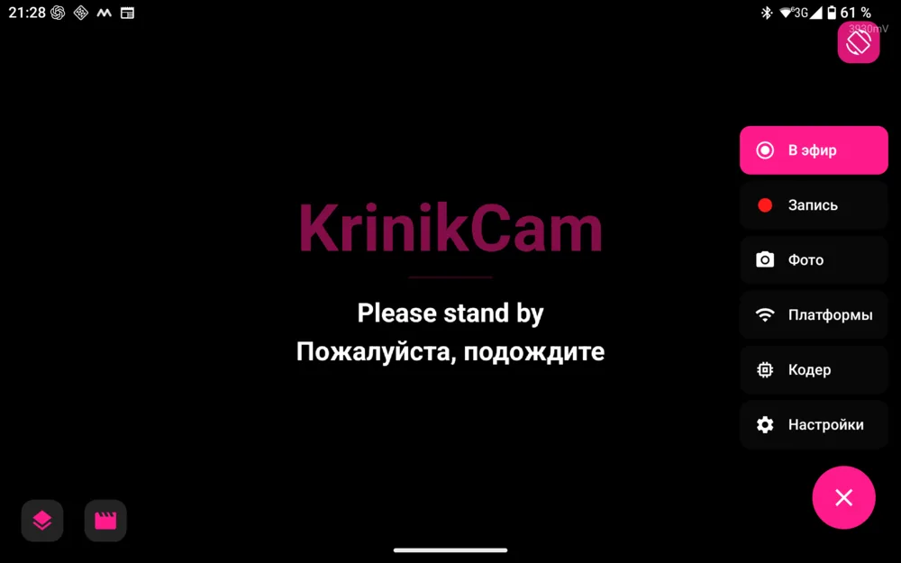

**English** · [Русский](#russian)

2026-10-17 · Minsk

KrinikCam 0.9 — the mobile OBS for Android grows up: named scenes with smooth transitions, a live stream that survives a bad network, and a clean release build. What the app does and how to start: [README](https://github.com/MikalaiKryvusha/KrinikCam#readme).

### 📦 Download

`KrinikCam-v0.9.apk` below — Android 13 or newer, 64-bit. When Android asks, allow your browser to install apps.

> ⚠️ **This release is signed with a NEW key.** If you have an older KrinikCam installed, uninstall it first — Android will not update it in place.

### ✨ In this release

- **Scenes:** named scene sets with a manager panel; transitions between scenes (type and duration per scene), and the outgoing scene stays live while it fades out.
- **A stream that survives a bad network:** reconnect keeps trying until you press Stop; a watchdog notices a frozen connection in about 6 seconds instead of minutes; the adaptive bitrate has a floor set in the encoder profile.
- **A respectful slate:** when the connection drops, viewers see the last frame with a «connection is being restored» ribbon instead of a black screen.
- **Encoder profiles:** export and import, plus one import manager with an honest report.
- **A clean release build:** the developer menu and the debug tools now live only in the separate debug build; the release is shrunk and optimised by R8 (about 11 MB).
- **Fixes:** a crash when returning from Settings, a UVC camera reopen loop during a live stream, the selfie camera stuck on a placeholder, the live badge now says FILE when recording to a file, and more.
- Checked before release on HEADWOLF Titan 1 (Android 16): the update installs over the previous build, the main and the selfie cameras give a live picture, no crashes.

### Known limitations

- A USB UVC webcam was not re-checked with this release build; the phone's own cameras were.

---

[English](#english) · **Русский**

2026-10-17 · Минск

KrinikCam 0.9 — мобильный OBS для Android взрослеет: именованные сцены с плавными переходами, эфир, который переживает плохую сеть, и чистая релизная сборка. Что умеет приложение и как начать — в [README](https://github.com/MikalaiKryvusha/KrinikCam#russian).

### 📦 Скачать

`KrinikCam-v0.9.apk` ниже — Android 13 и новее, 64 бита. Когда Android спросит, разрешите браузеру устанавливать приложения.

> ⚠️ **Этот релиз подписан НОВЫМ ключом.** Если у вас стоит прежний KrinikCam, сначала удалите его — поверх Android его не обновит.

### ✨ В этом релизе

- **Сцены:** именованные наборы сцен с панелью-менеджером; переходы между сценами (тип и длительность у каждой сцены), уходящая сцена остаётся живой, пока гаснет.
- **Эфир, который переживает плохую сеть:** переподключение продолжается, пока вы не нажмёте «Стоп»; сторож замечает зависшее соединение примерно за 6 секунд вместо минут; у адаптивного битрейта есть нижняя граница в профиле кодера.
- **Уважительная заглушка:** когда связь рвётся, зрители видят последний кадр с лентой «связь восстанавливается», а не чёрный экран.
- **Профили кодера:** экспорт и импорт, плюс единый менеджер импорта с честным отчётом.
- **Чистая релизная сборка:** меню разработчика и отладочные инструменты теперь живут только в отдельной отладочной сборке; релиз сжат и оптимизирован R8 (около 11 МБ).
- **Исправления:** падение при возврате из настроек, петля переоткрытия UVC-камеры в прямом эфире, селфи-камера, застрявшая на заглушке, бейдж при записи в файл теперь пишет «ФАЙЛ», и другое.
- Перед выходом проверен на HEADWOLF Titan 1 (Android 16): обновление встаёт поверх прошлой сборки, основная и селфи-камера дают живую картинку, падений нет.

### Известные ограничения

- USB UVC-вебкамера с этой релизной сборкой повторно не проверялась; встроенные камеры устройства — проверены.
